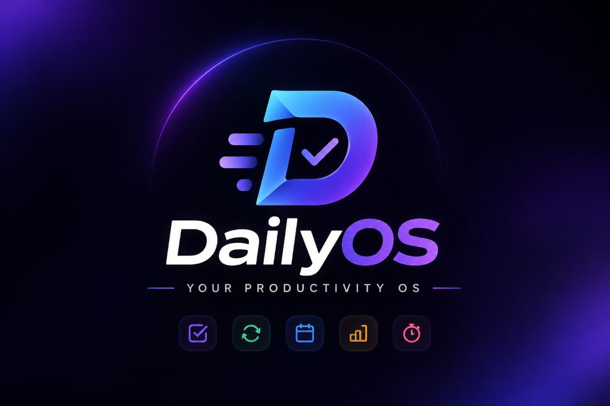
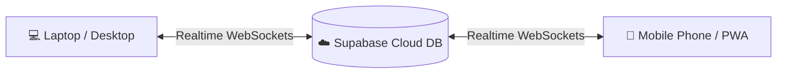

<div align="center">



# ⚡ DailyOS
### *Your Personal Productivity & Habit Management Operating System*

[](https://react.dev/)
[](https://vitejs.dev/)
[](https://tailwindcss.com/)
[](https://supabase.com/)
[](https://vercel.com/)
[](https://web.dev/progressive-web-apps/)

<p align="center">
  <b>DailyOS</b> is not just another basic to-do list. It is an all-in-one personal productivity platform that unifies <b>task execution</b>, <b>atomic habit discipline</b>, <b>goal roadmaps</b>, <b>focus sessions</b>, <b>calendar planning</b>, and <b>daily journaling</b> into a fast, elegant, distraction-free environment.
</p>

[Explore Features](#-key-features) •
[Tech Stack](#-tech-stack) •
[Quickstart](#-quickstart--local-setup) •
[Supabase Setup](#-database-setup-supabase) •
[Cross-Device Sync](#-cross-device-sync-phone--laptop)

</div>

---

## 🌟 Why DailyOS?

Most productivity apps are fragmented: one app for to-dos, another for habit tracking, another for journaling, and a timer for focus. 

**DailyOS brings everything together under one cohesive operating system**:
* ⚡ **Zero-Friction Startup**: Local-storage first architecture for instant loading, with background cloud backup.
* 🔄 **Real-Time Cross-Device Sync**: Powered by Supabase WebSockets. Update a habit on your phone, and your laptop updates in under 100ms.
* 📱 **Native App Experience**: Installable as a standalone Windows desktop software or as an iPhone/Android home-screen app.
* 🔒 **Data Privacy & Control**: Row Level Security (RLS) ensures only you have access to your private database records.

---

## 🚀 Key Features

### 1. 🎯 Daily Task Execution
* **Priority & Category Grouping**: Organize tasks with High, Medium, and Low priorities across color-coded categories (Work, Study, Fitness, Personal, Projects).
* **Smart Recurrence Engine**: Set tasks to automatically repeat Daily, on Weekdays, Weekly, or Monthly. Completing a task automatically schedules the next occurrence.
* **Time Estimates & Due Times**: Track estimated duration in minutes and assign specific due times to optimize your daily schedule.
* **Quick Add**: Global keyboard shortcut (`⌘K` / `Ctrl+K` or quick modal) to add tasks from any screen.

### 2. 🔥 Habit Tracker & Atomic Routines
* **Scientific Streaks**: Built-in streak engine with schedule awareness (missing days you didn't schedule never breaks your streak).
* **Multi-Format Habits**:
  * **Boolean**: Simple done/not-done check-offs (*Read 20 pages*, *No screens before bed*).
  * **Numeric**: Quantitative targets (*Drink 3L of water*).
  * **Duration**: Timed sessions (*90 minutes of Deep Coding*).
  * **Count**: Repetitions (*50 Push-ups*).
* **7-Day Completion Matrix**: Interactive weekly overview grid to log or review past habit completions with one click.
* **Curated Growth Library**: 1-click science-backed presets for hydration, deep work, reading, fitness, mindfulness, and sleep hygiene.

### 3. ⏱️ Focus Mode (Pomodoro Timer)
* **Customizable Pomodoro Cycles**: 25m Focus / 5m Short Break / 15m Long Break intervals with real-time circular SVG countdown.
* **Task Linking**: Attach any pending task directly to your focus session to track time spent on specific projects.
* **Ambient Audio**: Built-in soothing ambient sounds (Rain, White Noise, Cafe, Forest, Lo-Fi) to enter deep focus.
* **Session Logs**: Automatically saves focus minutes to daily productivity statistics.

### 4. 📅 Calendar & Interactive Timeboxing
* **Flexible Views**: Switch between Day, Week, and Month perspectives.
* **Visual Task Scheduling**: Filter tasks by category, monitor completion states, and plan deadlines visually.

### 5. 🎯 Long-Term Goal Management
* **Hierarchical Milestones**: Break big ambitions down into actionable milestone checklists.
* **Dynamic Progress Calculation**: Goals automatically calculate and visualize percentage completion based on completed milestones.
* **Target Dates & Categories**: Keep track of deadlines and categories for continuous personal growth.

### 6. 📖 Daily Growth Journal & Reflections
* **Daily Highlight**: Lock in your single "#1 Non-Negotiable Win" every morning.
* **Morning Intention & Evening Review**: Reflect on daily wins, lessons learned, and mood ratings (Excellent, Good, Neutral, Bad, Terrible).
* **1-Click Journal Push**: Save reflections directly into your permanent journal logs.

### 7. 📊 Productivity Analytics & Charts
* **Recharts Trendlines**: Visualize 7-day and 30-day productivity trends comparing completed tasks vs. completed habits.
* **Weekly Consistency Scores**: Track your discipline index and identify productivity patterns over time.

---

## 🛠️ Tech Stack

| Layer | Technologies |
| :--- | :--- |
| **Frontend** | React 19, JavaScript (ESNext), Vite 8 |
| **Styling & UI** | Tailwind CSS v4, Lucide React Icons, Canvas Confetti |
| **Routing** | React Router DOM v7 |
| **Data Visuals** | Recharts (Responsive Line & Bar Charts) |
| **Backend & Cloud** | Supabase (PostgreSQL, Supabase Auth, Row Level Security) |
| **Realtime Sync** | Supabase WebSockets (`supabase_realtime` publication) |
| **Date Utilities** | date-fns |
| **Deployment** | Vercel (CI/CD git-push deployments) |
| **Platform** | PWA (Progressive Web App with custom manifest & desktop mode) |

---

## 💻 Quickstart / Local Setup

Follow these steps to run DailyOS on your local machine:

### 1. Clone the repository
```bash
git clone https://github.com/kabirubale29/DailyOS.git
cd DailyOS
```

### 2. Install dependencies
```bash
npm install
```

### 3. Configure environment variables
Create a `.env` file in the project root:
```bash
cp .env.example .env
```
Add your Supabase credentials:
```env
VITE_SUPABASE_URL=https://your-project.supabase.co
VITE_SUPABASE_ANON_KEY=your-supabase-anon-public-key
```
*(If you leave these blank, DailyOS will automatically run in local-storage offline mode).*

### 4. Start development server
```bash
npm run dev
```

Open [http://localhost:5173/](http://localhost:5173/) in your browser.

---

## 🗄️ Database Setup (Supabase)

To enable cloud backup and real-time syncing:

1. Create a free project at [supabase.com](https://supabase.com).
2. Go to the **SQL Editor** on the left menu $\rightarrow$ click **New Query**.
3. Copy the entire contents of [`supabase-schema.sql`](./supabase-schema.sql) and paste it into the editor.
4. Click **Run**.

This script sets up:
* 10 PostgreSQL tables: `profiles`, `tasks`, `habits`, `habit_logs`, `goals`, `goal_milestones`, `focus_sessions`, `journal_entries`, `categories`, and `notifications`.
* Automated `uuid-ossp` keys and triggers for user onboarding.
* Row Level Security (RLS) policies guaranteeing user data isolation.
* Supabase Realtime broadcast channels for cross-device synchronization.

---

## 📱 Cross-Device Sync (Phone & Laptop)

DailyOS is engineered to keep your laptop and phone synchronized in real-time.



### Option A: Local Wi-Fi
If your phone is on the same Wi-Fi as your computer, run:
```bash
npm run dev -- --host 0.0.0.0
```
Open `http://<your-laptop-ip>:5173/` on your phone's browser.

### Option B: Cloud Deployment (Vercel)
1. Import this repository into [Vercel](https://vercel.com).
2. Add `VITE_SUPABASE_URL` and `VITE_SUPABASE_ANON_KEY` to **Project Settings $\rightarrow$ Environment Variables**.
3. Deploy! You will receive a permanent HTTPS link (e.g. `https://dailyos.vercel.app`) accessible anywhere on cellular or Wi-Fi.

### Install as a Native App:
* **Windows Laptop**: In Google Chrome, click the **Install** icon in the URL bar (or menu $\rightarrow$ *Save & Share* $\rightarrow$ *Install DailyOS as app*).
* **iPhone (iOS)**: In Safari, tap the **Share** button $\rightarrow$ select **"Add to Home Screen"**.
* **Android**: In Chrome, tap **⋮** $\rightarrow$ select **"Install app"** or **"Add to Home screen"**.

---

## 📂 Project Architecture

```text
dailyos/
├── public/                 # Static assets, logo artwork, PWA manifest
│   ├── favicon.png         # High-resolution tab icon
│   ├── logo.png            # Official brand banner
│   ├── logo-icon.png       # 3D glowing "D" app emblem
│   └── manifest.json       # Web App Manifest for native installation
├── src/
│   ├── assets/             # Component image assets
│   ├── components/         # Reusable modular UI components
│   │   ├── common/         # Buttons, cards, badges, modal dialogs, inputs
│   │   ├── dashboard/      # Daily highlight, weekly chart, statistics cards
│   │   ├── habits/         # Habit modals, growth presets, value loggers
│   │   ├── tasks/          # Task creation & category management
│   │   ├── goals/          # Milestone tracking & goal creators
│   │   ├── journal/        # Reflection modal & mood selector
│   │   └── layout/         # Persistent sidebar, mobile drawer, top navigation
│   ├── contexts/           # Global state providers (Auth, Data, Theme)
│   ├── lib/                # Supabase client initialization & configuration
│   ├── pages/              # Application views (Dashboard, Tasks, Habits, etc.)
│   ├── services/           # Data services & local/cloud API layers
│   └── utils/              # Streak calculation engine & UUID generators
├── supabase-schema.sql     # Complete PostgreSQL database schema & RLS rules
├── vercel.json             # SPA routing rewrite rules for Vercel deployment
└── vite.config.js          # Vite build and host configuration
```

---

## ⌨️ Keyboard Shortcuts

| Shortcut | Action |
| :--- | :--- |
| `⌘K` / `Ctrl+K` | Open Global Search |
| `Esc` | Close active modal dialog |

---

## 👤 Author

**Kabir Ubale**
* GitHub: [@kabirubale29](https://github.com/kabirubale29)

---

## 📄 License

This project is licensed under the [MIT License](LICENSE) — feel free to use and adapt it for your own personal growth routines.
